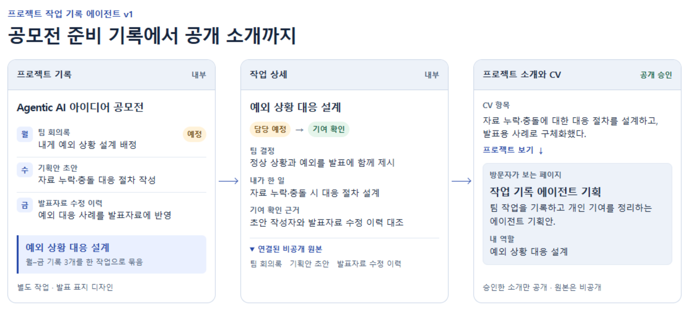

# 프로젝트 작업 기록 에이전트 v1

> [최신 v2 기획안](docs/v2/README.md) · [내부 작업 흐름과 시안](docs/v2/workspace.md)

**프로젝트 상태 · 공모전 기획안**

GitHub 커밋, 회의록, 실험 자료에서 날짜별 작업 일지를 자동으로 만들고, 며칠에 걸친 같은 작업을 하나의 블록으로 묶는 에이전트다. 사용자는 프로젝트 흐름과 자신의 기여를 확인하고, 같은 기록으로 프로젝트 소개 페이지와 CV 항목을 만들 수 있다. CV의 '프로젝트 보기'에는 사용자가 승인한 공개본이 연결된다.

## 사용 대상과 문제

수업·공모전·사이드 프로젝트를 진행하는 학생과 소규모 팀이 첫 이용 대상이다. 코드나 자료는 이미 저장해뒀어도 나중에 프로젝트를 소개하려면 커밋과 회의록을 다시 읽어야 한다. 특히 어떤 문제를 왜 다뤘는지, 팀이 정한 방향과 내가 직접 한 일이 각각 무엇이었는지 복원하는 데 시간이 든다.

## 사용 흐름

1. **프로젝트 연결** — GitHub 저장소 하나와 회의록·실험 자료를 올릴 폴더 하나를 지정한다. 원본은 기존 위치에 두고, 참조한 버전이나 위치를 기록에 연결한다.
2. **작업 일지 생성** — 새 자료가 들어오면 날짜별로 바뀐 점, 결정, 담당과 진행 상태를 정리한다. 사용자는 평소처럼 커밋을 올리거나 회의록을 저장한다.
3. **작업 블록으로 묶기** — 같은 이슈, 명시적으로 참조된 커밋, 공통 실험 샘플과 작업 목적을 확인해 관련 일지를 묶는다. 제목 아래에는 과정과 결과를 짧게 보여주고, 펼치면 날짜별 일지와 원본을 볼 수 있다.
4. **프로젝트 정리본 만들기** — 작업 블록을 바탕으로 프로젝트의 흐름, 팀 결과, 내 기여, 시행착오를 정리한다. 사용자가 블록을 합치거나 분리한 경우 그 결정을 이후 정리에 반영한다.
5. **소개 페이지와 CV 연결** — 사용자가 내보낼 작업을 고르면 소개 페이지와 CV 항목의 초안을 같은 기록에서 만든다. 사용자가 공개할 내용을 확인하고 승인하면 CV의 '프로젝트 보기'에서 해당 공개본을 열 수 있다.

## 공모전 준비 화면 예시

## 이용 예시

강의 PDF를 읽고 복습 문제를 만드는 팀 프로젝트를 예로 든다.

| 날짜 | 들어온 자료 | 작업 일지 |
| --- | --- | --- |
| 월요일 | 회의록에 긴 PDF에서 내용이 누락됐다는 보고와 분할 처리를 검토하자는 팀 결정이 남았다. 나는 두 가지 분할 방식의 비교를 맡기로 했다. | 팀 결정과 개인 담당을 구분한다. 방식 비교는 예정으로 기록한다. |
| 수요일 | 내가 올린 커밋에 두 가지 분할 방식의 구현이 들어 있다. 같은 날 로그인 화면 수정 커밋도 올라왔다. | 분할 관련 변경은 PDF 작업 블록에 추가한다. 로그인 수정은 별도 블록에 둔다. |
| 금요일 | 내가 작성한 실험표에 10쪽짜리 샘플, 두 방식의 설정과 결과가 기록됐다. | 두 방식을 구현하고 비교한 일을 개인 기여로 기록한다. 확인 범위는 해당 샘플로 남긴다. |

대표 작업 블록의 제목은 **긴 PDF의 내용 누락 개선**이다. 접으면 문제 발견, 팀의 결정, 내 작업과 비교 결과가 한눈에 들어온다. 펼치면 해당 날짜의 일지와 회의록, 커밋, 실험표를 열 수 있다.

소개 페이지에는 팀이 만든 복습 도구와 데모를 소개하고, 내 기여에는 두 분할 방식을 구현하고 비교한 과정을 담을 수 있다. 같은 기록에서 CV용 문장을 다음처럼 만든다.

> **강의 PDF 복습 도구** · 문서 분할 방식 두 가지를 구현하고 동일한 10쪽 PDF 샘플에서 결과를 비교했다. · 프로젝트 보기

## 자료가 애매할 때의 판단

| 상황 | 에이전트의 처리 |
| --- | --- |
| 같은 파일을 여러 작업에서 수정함 | 파일명과 함께 이슈, 변경 목적, 관련 메모를 확인한다. 연결 근거가 부족하면 별도 일지로 두고 사용자가 합칠 수 있게 한다. |
| 담당 배정은 확인됐지만 완료 근거가 없음 | 예정으로 남긴다. 완료 기록을 확인하면 갱신한다. CV에 쓰려는데 개인 기여가 여전히 애매하면 필요한 부분만 묻는다. |
| 회의록에는 '누락 해결'이라고 적혀 있고 실험표에는 샘플 한 개만 있음 | 작업 상세에 테스트 범위를 적고, CV에는 자료가 뒷받침하는 구현·비교 사실을 사용한다. |
| 원본을 열 수 없거나 접근 권한이 바뀜 | 내부 기록에서 해당 근거를 다시 확인해야 한다고 표시한다. 새 공개 초안에서는 확인 가능한 자료를 바탕으로 작성한다. |

작업 일지와 블록에는 날짜, 팀 결정, 내 기여, 확인 상태, 원본의 위치와 버전이 연결된다. 에이전트는 새 자료가 해당 블록에 들어갈 근거가 있는지 확인하고, 출력물의 역할과 수치가 원본 범위 안에 있는지 점검한다.

## 기본 양식과 설정

기본 화면은 **블록형**이다. 작업한 날을 한눈에 보고 날짜를 누르면 그날의 일지가 열린다. 여러 날에 걸친 작업은 한 블록으로 접어둔다. **줄글형**을 선택하면 같은 기록을 회고 문단으로 읽을 수 있다.

설정에서는 미리 마련된 화면 유형을 고른 다음, 그 안에 담을 항목·순서·분량을 프롬프트로 지정할 수 있다. 예를 들어 블록형을 고르고 “내가 한 일을 먼저 보여주고, 팀 결정과 실험 결과를 그다음에 넣어줘. 중간 시도는 한 줄씩 정리해줘”라고 적는다. 어떤 양식을 고르든 날짜, 기여 구분, 원본 연결은 공통으로 저장한다.

## 공개 페이지와 CV

**내부 기록**에는 작업 일지, 시행착오, 회의록, 비공개 코드와 실험 자료를 보관한다. **공개 페이지**에는 사용자가 승인한 최종 소개본과, 사용자가 따로 공개하기로 승인한 블록이나 자료만 표시한다.

CV의 '프로젝트 보기'는 이 공개 페이지를 연다. 에이전트가 새 소개 초안을 작성하면 공개 페이지에는 마지막으로 승인한 버전이 유지된다. 같은 작업 기록은 필요에 따라 Velog 회고나 LinkedIn 소개 글의 초안으로도 쓸 수 있다.

## v1 검증 기준

대표 사용 범위는 GitHub 저장소 하나와 연결한 자료 폴더 하나다. 공모전에서는 **회의록의 담당 예정이 실험표가 들어온 뒤 확인된 개인 기여로 바뀌고, 그 기록이 프로젝트 소개 페이지와 CV에 연결되는 과정**을 보여준다.

같은 커밋·회의록·실험표를 일반 AI에도 주고 출처까지 붙여 정리를 요청한 뒤 비교한다. 사용자가 자료를 다시 찾아 연결하는 데 걸린 시간과, 잘못 묶인 작업이나 개인 기여를 바로잡은 횟수를 기록한다. 내부 화면에서 소개 문장과 CV 항목의 원본을 찾을 수 있는지, 외부에서는 승인한 내용만 보이는지도 확인한다.
