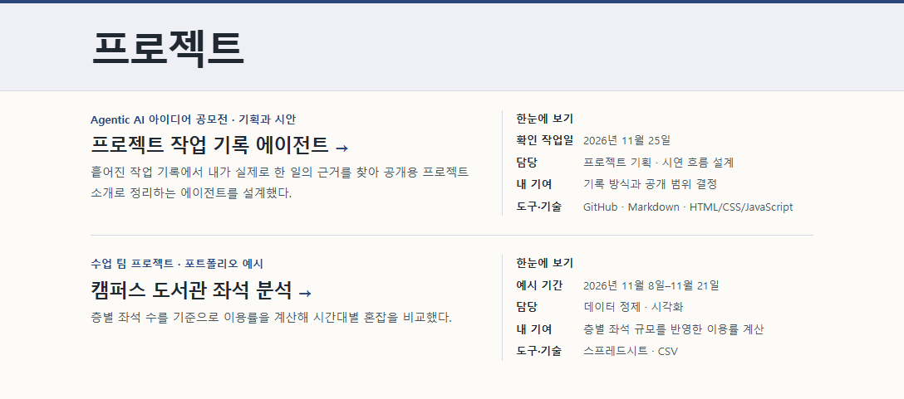
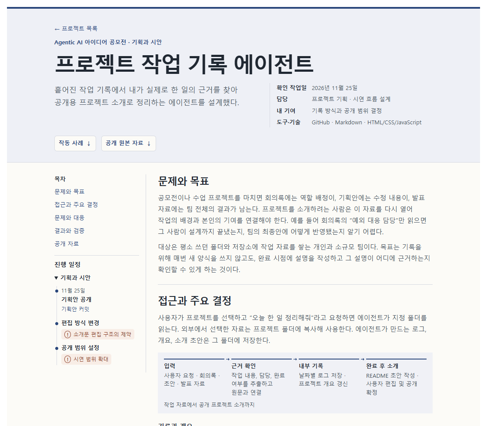
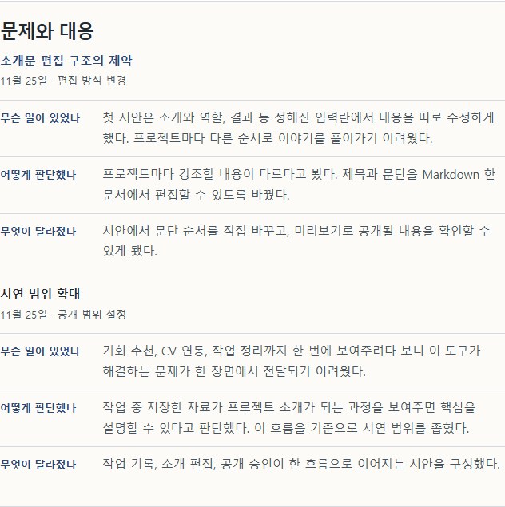

# 프로젝트 작업 기록 에이전트 v2

**Agentic AI 아이디어 공모전 기획안 · 2026년 11월 25일**

공모전을 준비하는 사람이 “오늘 한 일 정리해줘”라고 말하면, 에이전트가 지정한 프로젝트 폴더의 회의록·초안·코드·발표 자료를 읽는다. 날짜별 작업 로그를 남기고 최신 개요를 갱신한다. 완료 후에는 확인된 작업과 원본 근거를 바탕으로 프로젝트 소개 보고서 초안을 만들고, 사용자가 확정한 내용과 자료만 공개본에 담는다.

## 어떤 문제를 해결하는가

파일을 보관해도 나중에 프로젝트를 설명할 때 “무엇을 왜 바꿨고, 내가 직접 한 일은 무엇인가”를 복원하려면 여러 기록을 다시 읽어야 한다. 회의록의 역할 배정, 문서의 작성 이력, 발표 자료의 팀 성과는 서로 다른 근거다. 작업 중에는 구분해서 쌓고, 소개를 작성할 때 관련 근거를 다시 찾을 수 있게 한다.

## 공모전 시연 흐름

1. **프로젝트 선택** · 여러 프로젝트 중 공모전 준비 프로젝트를 선택하고, 자료를 지정 폴더에 넣거나 외부 자료를 골라 사본으로 가져온다.
2. **오늘의 정리 요청** · 새 자료와 기존 기록을 비교한다. 회의록의 “예외 대응 담당”은 역할 배정으로, 팀 발표 자료 반영은 팀 결과로 남긴다.
3. **새 근거 확인과 갱신** · 초안의 변경 구간과 검토 기록에서 작성 내역이 확인되면 개인이 한 일을 로그에 추가하고 개요를 갱신한다. 근거가 모호하면 해당 기록에 표시하고, 정리는 계속한다.
4. **완료와 공개본 편집** · 프로젝트 완료 후 초안을 README처럼 편집한다. 공개본을 미리 보고 문안과 첨부 자료를 확인한 뒤 확정한다.

## 공개 프로젝트 소개 시안

[인터랙티브 HTML](previews/public-project-report.html) · GitHub에서 캡처를 바로 볼 수 있다. HTML은 내려받아 브라우저로 열면 화면 이동이 된다.

### 프로젝트 목록

제목과 핵심 요약 옆에서 기간 또는 확인 작업일, 역할, 주요 기여, 도구를 빠르게 읽는다. 프로젝트를 선택하면 전체 보고서가 열린다.

### 프로젝트 상세 보고서

첫 화면의 요약에서 본문으로 이어진다. 목차 아래의 세로 일정에는 완료 후 확인한 주요 사건을 날짜와 함께 정리한다. 일정이 길면 단계별로 접을 수 있다. 느낌표가 붙은 명사형 제목을 누르면 본문의 해당 사례로 이동한다.

본문에는 문제와 목표, 접근과 주요 결정, 문제와 대응, 결과와 검증, 공개 자료가 들어간다. 문제 사례는 상황과 영향, 대응, 결과를 함께 보여준다. 승인한 최종 발표본·보고서나 시각 자료를 관련 설명에 붙일 수 있다. AI 활용은 작업 결과를 이해하는 데 필요할 때 상세에서만 설명하고, 사람이 맡은 판단과 검증을 함께 적는다.

## 심사 기준을 어떻게 보여주는가

| 항목 | 기획안에서 보여줄 내용 |
| --- | --- |
| Agentic 설계 · 60점 | 기존 상태와 새 자료를 비교하고, 우선 찾을 근거를 정한다. 역할이 배정된 상태와 실제 작업이 확인된 상태를 구분해 필요한 로그와 최신 개요를 갱신한다. |
| 문제의 필요성 · 15점 | 공모전이 끝난 뒤 작업 경위와 개인 기여를 다시 찾아야 하는 상황을 공모전 준비 사례로 재현한다. |
| 실현 가능성 · 15점 | 프로젝트별 지정 폴더에서 시작한다. 기록과 문안에는 근거 위치를 남기고, 삭제와 공개본 확정에는 사용자의 확인을 받는다. |
| 이용 편의와 설명의 명확성 · 10점 | 정리 요청은 채팅 한 줄로 받는다. 개요·로그·편집을 각각 확인하고, 공개 목록에서는 핵심 정보부터 읽을 수 있게 한다. |

화면은 예시 자료로 작동하는 기획 시안이다. 구현 검증 시에는 같은 입력으로 수동 정리, 한 번의 AI 요약, 에이전트 처리 과정을 비교한다. 공개 초안 검토까지 걸린 시간, 작성자 귀속 오류, 근거를 다시 찾은 횟수, 승인 범위 밖 자료가 공개되는지를 기록한다.

- [내부 작업 흐름과 시각화 자료](workspace.md)
- [v1 기획안](../v1/README.md) · [v1 시각화](../competition-workflow-v1.png) · [버전별 수정 사항](../../README.md)
