# 내부 작업 흐름과 화면 시안

공모전 팀 프로젝트를 예시로, 진행 중에 자료를 쌓고 최신 개요를 확인한 뒤 완료 시점에 보고서로 가공하는 흐름이다. 아래 캡처와 HTML은 화면 설계를 보여주는 예시다.

## 1. 프로젝트별로 작업 범위 지정

- 여러 프로젝트 중 작업할 프로젝트를 선택한다. 각각 작업 자료, 개요, 날짜별 로그, 소개 초안이 있는 지정 폴더를 가진다.
- 기존 폴더나 GitHub에서 사용자가 지정한 자료를 사본으로 가져온다. 에이전트가 만드는 파일과 수정·분류하는 자료는 이 프로젝트 폴더 안에 둔다. 가져온 자료에는 확인 가능한 원본 위치나 버전을 남긴다.
- 같은 폴더에 새 자료를 추가하고 “오늘 한 일 정리해줘”라고 요청한다. 기록용 양식을 추가로 작성할 필요 없이, 있는 자료부터 정리한다.

## 2. 최신 개요와 날짜별 로그

| 화면 | 보는 내용 | 갱신 방식 |
| --- | --- | --- |
| 최신 개요 | 현재 목표와 상태, 내 역할, 핵심 결정과 결과 | 확인된 변경을 반영해 최신 설명을 갱신 |
| 날짜별 작업 로그 | 기록한 날, 결정과 작업, 개인과 팀의 구분, 연결된 근거 | 같은 날 여러 건을 남길 수 있고, 이전 기록은 날짜별로 열어봄 |
| 자료 목록 | 이미지, PDF, 텍스트, 코드와 원본 연결 | 종류별로 나눈 뒤 각 그룹 안에서 시간순 정리 |

자료가 추가되면 연결되는 작업이 있는지 확인한다. 이미 기록한 내용을 반복하는 참고 자료는 기존 항목에 연결한다. 개요에는 프로젝트 상태나 결과의 설명이 달라지는 변경을 반영한다. 자료의 추가 날짜와 실제 작업 날짜가 다르면 기록에 드러낸다. 날짜나 역할이 불명확하면 빈칸이나 확인 표시를 남기고, 다음 작업을 계속한다.

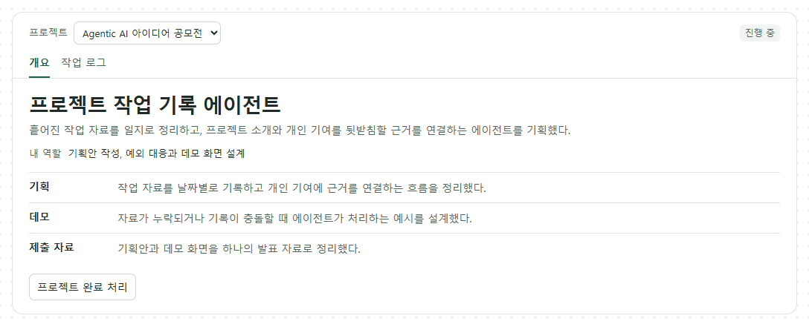

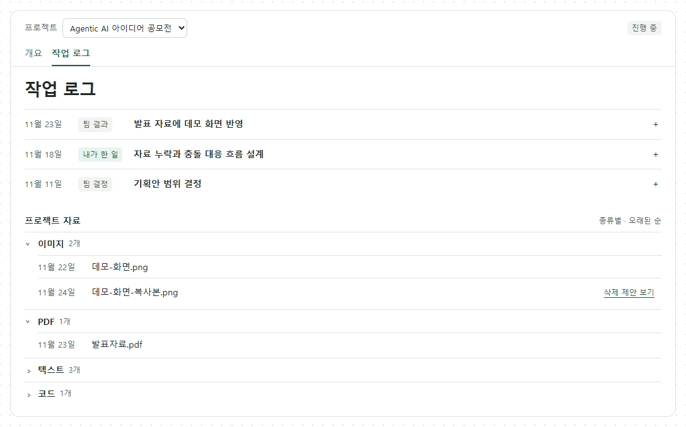

## 3. 근거를 확인하고 예외를 처리하는 방식

로그는 구체적인 사건과 근거를 연결한다. 회의록에서 “예외 대응 담당”을 읽으면 예정된 역할로 저장한다. 문서 변경 내역과 리뷰를 통해 예외 대응 절의 작성자가 확인되면 개인 작업으로 남긴다. 발표본에 해당 절이 반영된 사실은 별도의 팀 결과로 기록한다. 작성자와 실제 기여가 다를 수 있으므로 파일을 마지막으로 저장한 사람만으로 판단하지 않는다.

| 상황 | 에이전트의 처리 |
| --- | --- |
| 하루에 여러 결정이나 작업이 들어옴 | 영향을 받는 로그를 연결된 근거와 함께 각각 기록하고, 최신 개요에 필요한 내용만 반영한다. |
| 자료가 없거나 작성 기록이 충돌함 | 확인된 범위와 미확인 부분을 남긴다. 공개 문안에 개인 귀속이 필요한 경우에 해당 항목만 묻는다. |
| 같은 파일의 복사본 발견 | 로그와 공개 초안에서 참조 중인지 확인하고, 사본과 삭제 이유를 보여준다. 사용자가 승인한 프로젝트 폴더 내 사본만 삭제한다. |
| 정리 요청을 다시 실행함 | 같은 자료와 버전의 기존 기록을 확인하고, 새로운 변경이나 근거가 생긴 항목을 갱신한다. |

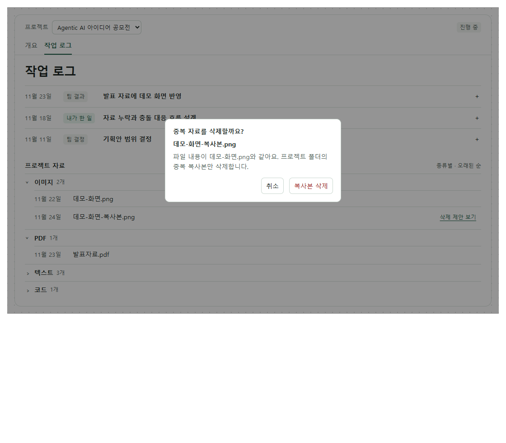

## 4. 프로젝트 완료와 소개 보고서 작성

1. 사용자가 완료 처리하면 최신 개요와 근거를 확인한 로그에서 소개 보고서 초안을 만든다.
2. GitHub 프로젝트 README처럼 Markdown으로 본문 전체를 편집한다. 사용자가 읽을 순서로 문단을 바꾸고, 이미지·보고서·최종 발표본을 관련 문단에 연결할 수 있다.
3. 내부에서 기여 문장과 연결된 로그나 자료를 열어 근거를 확인한다. 공개 화면에는 확정한 문안과 별도로 승인한 첨부 자료만 반영한다.
4. 보고서의 진행 일정은 완료 후 중요한 사건을 골라 작성한다. 작업 로그는 내부에서 검색하고 복기할 때 사용한다.

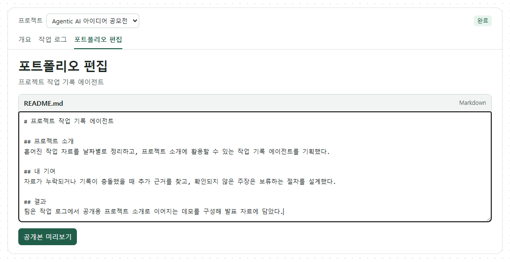

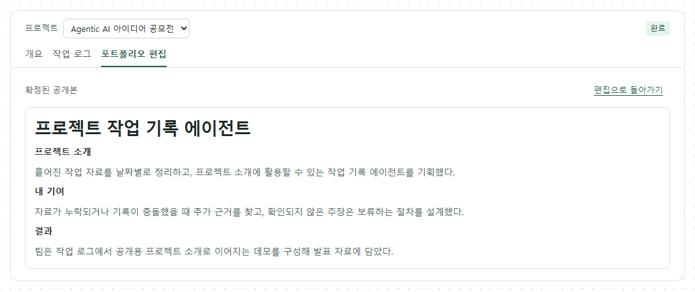

[내부 작업부터 공개본 확정까지의 HTML](previews/project-log-portfolio.html) · [공개 소개 시안](README.md#공개-프로젝트-소개-시안)

## 진행 중에 검토한 화면

날짜별 기록, 전체 흐름, 작업의 세부 근거를 각각 그려 보고 한 화면에 어느 정도를 보여줄지 검토했다. 아래는 이 과정에서 만든 내부 시안이다. HTML은 파일을 내려받아 브라우저로 열 수 있다.

### 프로젝트 전환과 최신 개요

[HTML](previews/project-current-overview.html)에서 예시 프로젝트를 전환해 볼 수 있다.

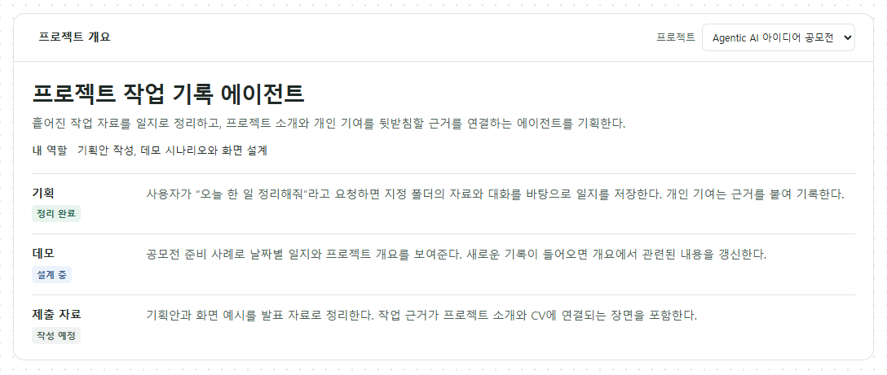

### 날짜별 로그와 기록 캘린더

[HTML](previews/contest-worklog-page-daily.html)에서 기록이 있는 날을 고르고 해당 날짜의 로그를 펼칠 수 있다.

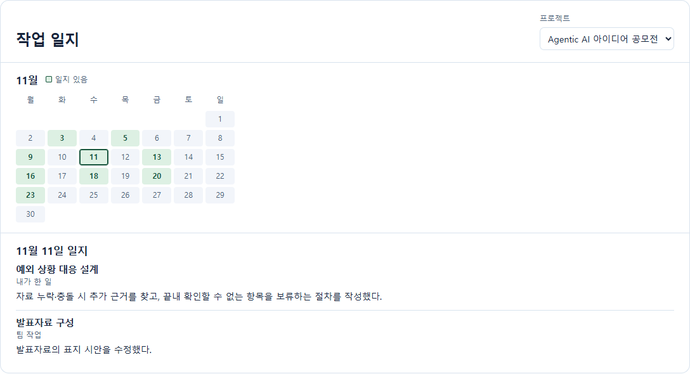

### 프로젝트의 큰 흐름

[HTML](previews/contest-worklog-page-flow.html)은 날짜별 로그를 훑기 전에 어떤 단계에서 무슨 일이 있었는지 보는 시안이다.

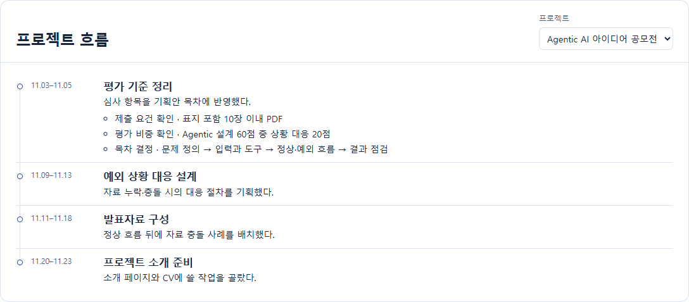

### 작업 상세와 근거

[HTML](previews/contest-worklog-page-detail.html)에서는 팀과 개인 기록을 골라 보고 작업에 연결된 근거를 읽을 수 있다.

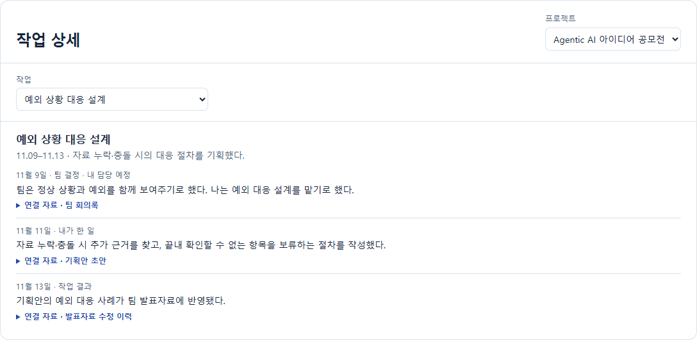

### 캘린더·흐름·세부 기록을 배치한 초기 제안

[HTML](previews/contest-worklog-timeline.html)은 날짜 선택, 전체 흐름, 작업 상세를 한 시안으로 처음 묶어본 화면이다.

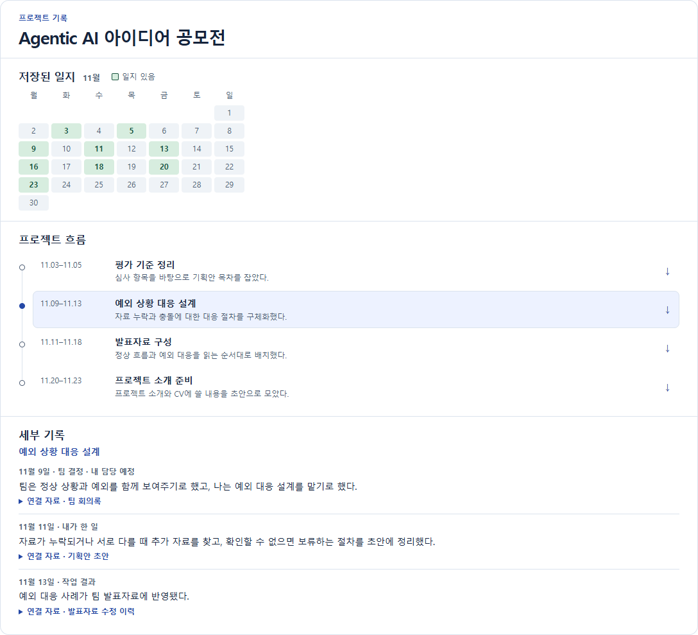

### 비공개 문제·대응 태그

여러 프로젝트에 흩어진 대응 사례를 기술·관계와 협업·기획 등의 맥락으로 다시 찾아보는 내부 시안이다. [HTML](previews/private-response-tags.html)에서 태그를 골라볼 수 있다. 예시 화면만 저장소에 포함했다.

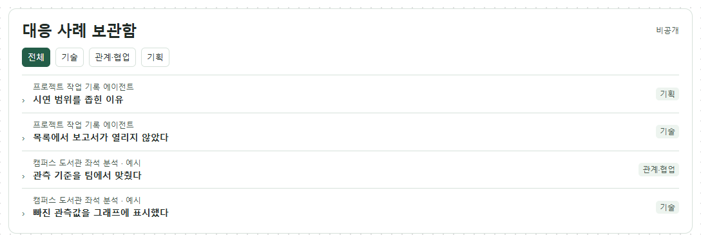

### 브랜치와 수정 이력 검토

방향 전환을 추적할 수 있도록 브랜치와 버전별 변경 보기도 검토했다. 현재안에서 상시 확인하는 화면은 최신 개요이며, 지난 작업을 복기할 때 날짜별 로그를 연다.

| 내부 시안 | 살펴본 질문 |
| --- | --- |
| [방향 변경 브랜치 HTML](previews/project-direction-branches.html) | 계획이 변경될 때 방향 전환을 별도 가지로 표현하면 읽기 편한가 |
| [수정 이력 HTML](previews/project-revision-history.html) | 주요 버전 변경의 전후를 볼 때 어떤 정보가 필요한가 |

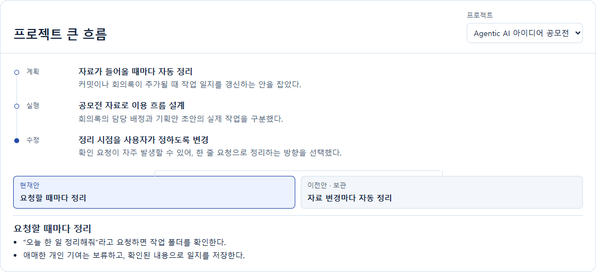

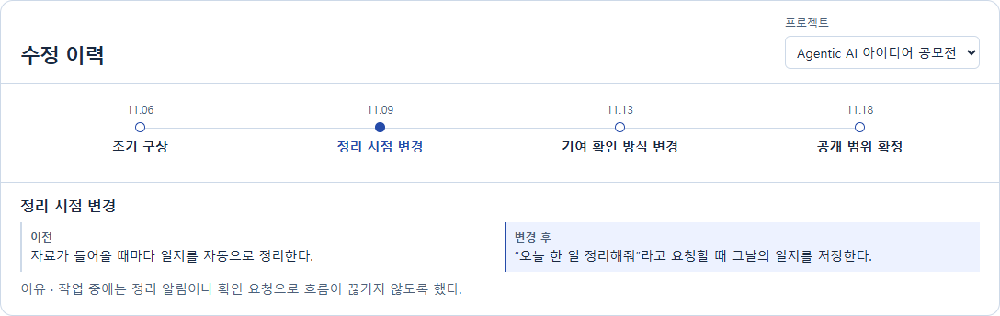
