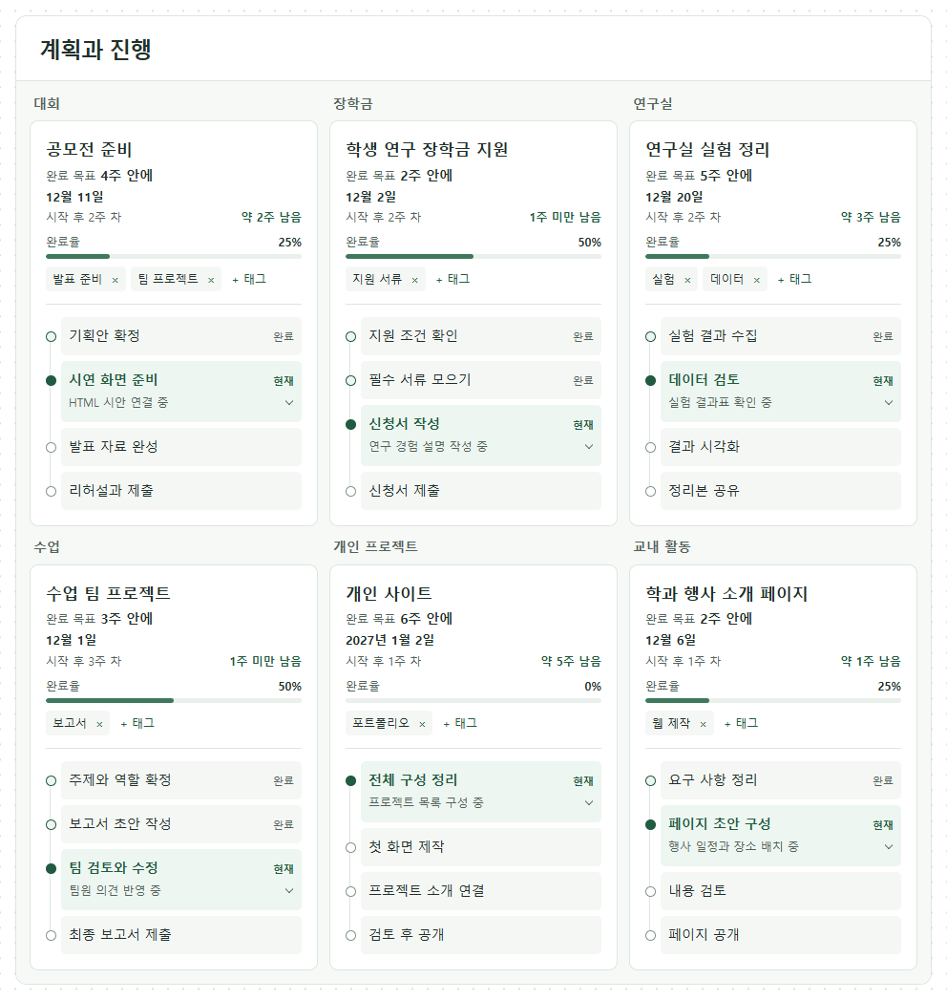
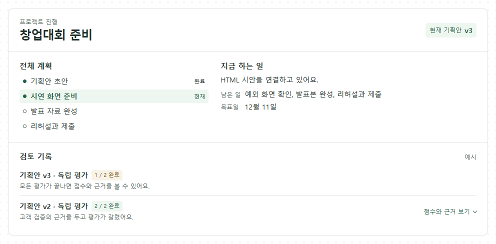
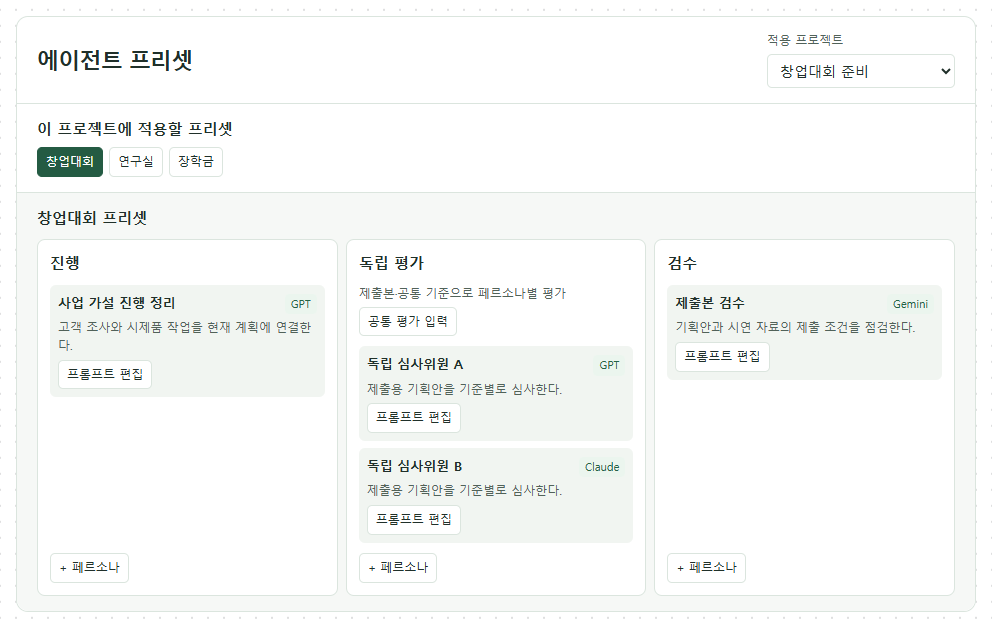

# 프로젝트 작업 기록 에이전트 v3

**Agentic AI 아이디어 공모전 기획안 · 2026년 11월 26일**

프로젝트를 시작할 때 전체 계획을 잡고, 진행 중에는 채팅 한 줄로 실제 작업과 산출물을 정리한다. 에이전트는 그 기록을 현재 계획에 연결해 어디까지 진행했고 목표까지 무엇이 남았는지 보여준다. 프로젝트가 끝나면 같은 기록과 자료로 공개용 프로젝트 소개 페이지의 초안을 만든다.

## 사용 상황

공모전, 수업, 연구실 프로젝트를 겹쳐 진행하는 학생은 시작할 때 만든 계획표와 실제 진행 상황을 따로 갱신하기 쉽다. 발표 자료, 코드, 회의록은 또 다른 곳에 쌓인다. 기획이나 시연 방향이 바뀌면 무엇이 남았는지 파악하는 데 시간이 들고, 끝난 뒤 소개 페이지를 만들 때는 자료를 다시 찾아야 한다. v3는 **현재 계획, 실제 작업, 완료 후 쓸 산출물**을 같은 프로젝트에서 이어서 관리하는 흐름을 제안한다.

## 1. 전체 계획과 목표일

사용자는 “4주 안에 공모전 기획안과 시연을 준비하고 싶어. 계획 잡아줘”처럼 목표와 기간을 말한다. 에이전트는 기획안 확정, 시연 준비, 발표 자료 완성, 리허설과 제출처럼 시작부터 끝까지의 주요 단계를 제안한다. 목표일과 진행 중 확인할 산출물을 가능한 범위에서 정한다. 공식 공고가 연결되어 있으면 제출 조건과 마감도 참고한다. 사용자가 계획을 받아들이면 그 계획이 이후 진행을 판단할 기준이 된다.

계획은 개략적인 주 단위로 시작한다. 목표일이 정해지면 날짜를 표시하고, 특정 작업 시간을 잡고 싶을 때 구글 캘린더에 연결할 수 있다. 프로젝트 진행 화면에는 바뀐 내용을 반영한 최신 계획 전체가 보인다.

## 2. 여러 프로젝트를 한 화면에서 보기

**계획과 진행**에서는 프로젝트를 대회, 장학금, 연구실, 수업, 개인 프로젝트, 교내 활동 같은 종류별로 묶어 나란히 배치한다. 각 프로젝트는 독립된 블록이고, 아래로 스크롤하면 다음 프로젝트가 이어진다.

- 상단에서 **완료 목표 기간, 목표일, 현재 주차, 목표까지 남은 기간, 완료율**을 확인한다.
- 그 아래에 전체 계획을 세로 블록으로 표시한다. 현재 진행 중인 단계에는 지금 하는 일이 한 줄로 보이고, 펼치면 남은 일을 확인할 수 있다.
- 완료율은 현재 계획에서 **완료한 단계 수를 전체 단계 수로 나눈 값**이다. 진행 중인 작업의 시간이나 난이도는 현재 단계의 설명에서 읽는다.
- 종류로 프로젝트를 모아 보고, 프로젝트마다 **발표 준비**, **포트폴리오**, **지원 서류** 같은 태그를 직접 추가하거나 지울 수 있다.

[클릭해 볼 수 있는 계획과 진행 시안](previews/parallel-project-plans.html) · HTML을 내려받아 브라우저에서 열면 현재 작업을 펼치거나 태그를 편집할 수 있다.

## 3. 기록 한 줄로 현재 계획과 산출물 갱신

“오늘 HTML 시안 연결했고 예외 화면은 확인 중이야. 정리해줘”라고 요청하면 에이전트가 날짜별 로그를 만들고, 지정 프로젝트 폴더의 관련 시안이나 메모를 찾아 연결한다. 개요에서는 이 작업을 **시연 준비**에 연결해 현재 상태와 남은 일을 갱신한다. PDF, 이미지, 텍스트, 코드 같은 자료는 유형별로 모아두고, 로그에서 관련 파일을 열 수 있다.

작업 도중 “영상 대신 HTML로 시연하자”라고 결정하면 시연 단계의 계획과 완료 기준을 갱신한다. “HTML도 시험해봤어”라는 말은 시도한 작업으로 기록한다. 이후에는 현재 계획과 실제로 남긴 기록을 바탕으로 **“지금 어디까지 왔어?”**, **“목표일까지 어떤 일이 남았어?”**에 답할 수 있다.

개별 프로젝트의 진행 화면 상단에는 **현재 기획안 버전**을 표시한다. 하단의 **검토 기록**에서는 평가 대상이 된 버전과 완료 상태를 보여준다. 현재 기획안이 v3이고 v2의 평가가 끝났다면, v2 결과는 해당 버전의 기록으로 다시 열어볼 수 있다. 독립 평가 점수와 근거는 해당 버전의 개별 평가가 모두 확정되면 기준별로 비교할 수 있게 펼쳐진다.

[클릭해 볼 수 있는 프로젝트 진행 화면](previews/project-progress-reviews.html) · [기준별 점수와 근거 비교](screenshots/project-review-comparison.png)

## 4. 완료 후 공개용 프로젝트 소개

사용자가 프로젝트를 완료하면 최신 개요, 필요한 작업 로그, 보관한 산출물로 프로젝트 소개 페이지의 초안을 만든다. 작업 중에 적어둔 주요 결정과 문제 대응을 필요에 따라 본문에 넣고, 최종 발표본과 이미지 같은 자료를 재사용한다. 사용자가 README 방식으로 문안을 편집하고, 공개할 파일과 내용이 맞는지 미리 본 뒤 확정한다.

[내부 작업 로그·자료 정리·공개 승인 화면](../v2/workspace.md) · [공개 프로젝트 목록과 상세 보고서 시안](../v2/README.md#공개-프로젝트-소개-시안)

## 5. 프로젝트 유형별 에이전트 프리셋

프로젝트에 **창업대회, 연구실, 장학금** 같은 유형별 프리셋을 적용한다. 프리셋 안에는 **진행, 독립 평가, 검수** 블록이 있다. 각 블록에 페르소나를 여러 개 둘 수 있고, 각각의 **AI 모델, 역할, 구체적인 목표, 추가 지시와 출처**를 저장한다. 공모전 평가표나 공개 오픈소스 프로젝트의 체크리스트를 쓸 때는 해당 항목을 평가 기준이나 검수 프롬프트에 넣는다.

| 프리셋 | 진행 | 독립 평가 | 검수 |
| --- | --- | --- | --- |
| 창업대회 | 고객 조사와 시제품 작업 기록 | 제출용 기획안을 문제 정의·고객 검증·실행 계획 기준으로 심사 | 필수 항목, 파일 형식과 시연 링크 점검 |
| 연구실 | 실험 조건과 관측 결과 정리 | 비교 조건과 결론의 근거를 독립적으로 검토 | 표·그래프의 단위와 원본 자료 연결 점검 |
| 장학금 | 신청 준비 상태 정리 | 제출용 신청서의 답변을 문항별로 평가 | 마감, 필수 서류와 첨부 형식 확인 |

**독립 평가**에 GPT와 Claude를 각각 지정한 심사위원이 있다면, 같은 제출본과 공통 평가 기준을 사용해 각자의 새 세션에서 평가한다. 입력은 공통 자료와 해당 페르소나의 프롬프트로 제한한다. 평가 결과에는 점수, 제출본에서 확인한 근거, 보완점을 남기고 개별 기록이 확정된 뒤 한 화면에서 비교한다. **검수**에서는 제출에 필요한 항목이 실제로 존재하고 열리는지 확인한다.

사용자는 “이 제출본을 독립 평가해줘”처럼 AI에게 요청한다. AI는 현재 프로젝트에 적용한 프리셋의 해당 블록에서 저장된 프롬프트를 가져온다. 같은 프리셋을 쓰는 프로젝트도 페르소나 구성과 공통 기준을 따로 저장할 수 있다.

[클릭해 볼 수 있는 프리셋 시안](previews/project-agent-settings.html) · [페르소나 편집과 독립 평가 입력](screenshots/project-agent-editor.png)

## 확장 방향 · 내 작업 방식

사용자가 회고를 요청하면 계획과 작업 기록에서 반복된 진행 방식을 찾아 개선점을 제안한다. 가령 두 프로젝트에서 초안 검토가 마감일에 몰렸다면, 다음 프로젝트 계획에 사전 검토 시간을 넣어보자고 조언할 수 있다. 사용자가 “이건 기억해둬”라고 한 내용은 **내 작업 방식**에 근거와 함께 저장한다. 이후 계획에 참고하며 사용자가 직접 수정하거나 지울 수 있다.

## 공모전에서 보여줄 흐름

1. 공모전 프로젝트의 4주 계획을 만들고, 여러 프로젝트가 나란히 있는 화면에서 현재 위치와 목표일을 확인한다.
2. 작업 내용을 채팅 한 줄로 남긴다. 날짜별 로그, 관련 산출물, 전체 계획 속 현재 단계가 연결되는 것을 보여준다.
3. 시연 방식 변경을 입력한다. 기존 기록을 바탕으로 새 계획에서 완료된 일과 남은 일을 다시 확인한다.
4. 완료된 프로젝트의 소개 초안을 열고, 이미 정리된 시안과 발표 자료를 확인한 뒤 공개할 내용을 확정한다.

[에이전트 판단 기준과 검증 시나리오](workflow.md) · [버전별 수정 사항](../../README.md)

**기획 및 시안 범위** · 예시 데이터에서 프로젝트별 프리셋 적용, 페르소나와 AI 모델 지정, 프롬프트 편집, 페르소나별 평가 입력 확인, 완료된 버전의 평가 결과 비교를 체험할 수 있다. 이번 평가에 붙여넣은 제출본은 열린 시안에서만 사용하고, 공통 평가 기준과 페르소나 설정은 저장한다. 실제 모델 실행, 자동 기록 갱신과 캘린더 연결은 기획에 포함된 동작이다.
