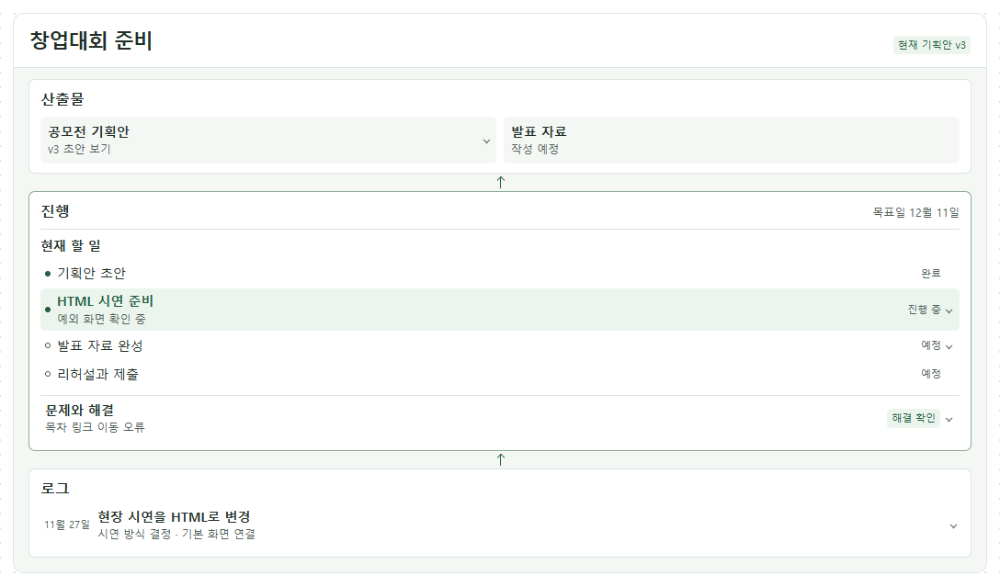
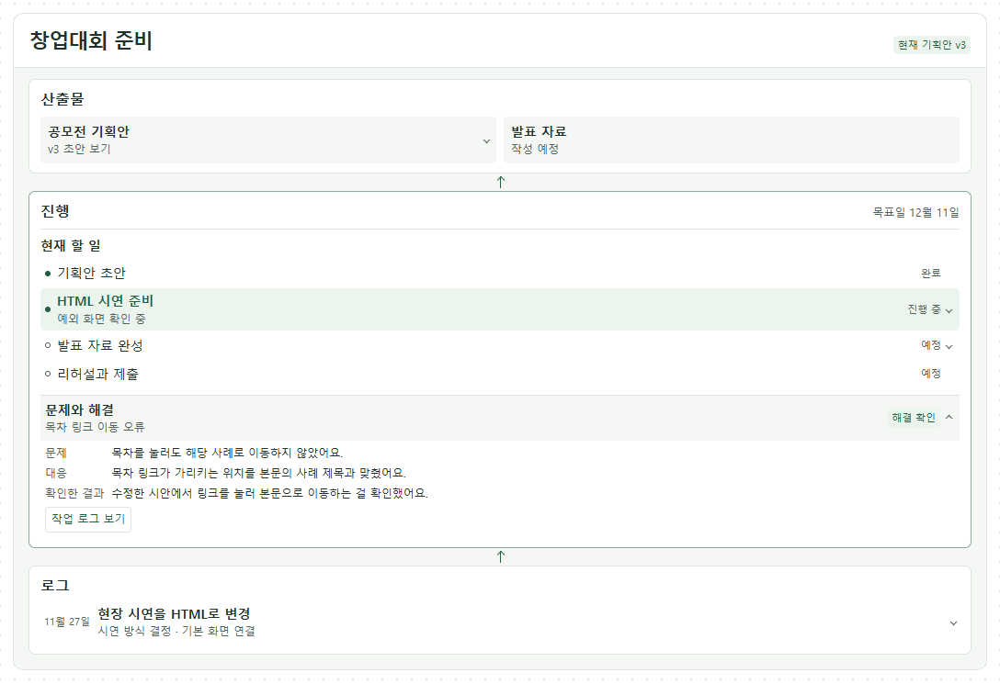

# 프로젝트 작업 기록 에이전트 v4

**Agentic AI 아이디어 공모전 기획안 · 2026년 11월 27일**

프로젝트 중에 한 일이나 바뀐 결정을 채팅에 한 줄 남기면, 에이전트가 관련 계획과 자료를 찾아 갱신한다. 사용자는 프로젝트 창 하나에서 지금 할 일, 실제 산출물, 그 근거를 다시 볼 수 있다. 완료 후에는 같은 기록으로 내가 한 일과 문제 해결 과정을 담은 프로젝트 소개를 만든다.

## 해결하려는 문제

공모전 팀이 시연 방식을 바꾸면 할 일 목록, 발표 자료와 리허설 준비가 함께 바뀐다. 자료가 다른 곳에 쌓이면, 사용자는 어디까지 반영했는지 나중에 다시 확인해야 한다. 프로젝트를 마친 뒤 소개를 쓸 때는 어떤 문제가 있었고 본인이 무엇을 했는지도 찾아야 한다. 한 번의 기록을 현재 계획과 관련 산출물에 연결해 이 수고를 줄인다.

## 프로젝트 창 하나

| 위치 | 보는 정보 |
| --- | --- |
| **위 · 산출물** | 현재 기획안 버전, 열어볼 수 있는 초안, 준비 중인 발표 자료, 완료 후 승인한 프로젝트 소개 |
| **가운데 · 진행** | 목표일과 현재 할 일. 할 일을 펼치면 완료 조건, 연결된 자료, 그 결과물에 더 넣어야 할 내용을 확인한다. 할 일 목록 아래에 **문제와 해결**을 따로 둔다. |
| **아래 · 로그** | 날짜별 작업, 팀 결정, 개인 기여와 연결된 자료. 관련 계획 단계나 문제 해결 사례를 같은 창에서 열 수 있다. |

[클릭할 수 있는 세 층 시안](previews/project-workflow-layers.html)

## 한 줄 기록이 반영되는 곳

> “현장에서는 영상 대신 HTML로 시연하자. 기본 화면은 연결했고 예외 화면은 확인 중이야.”

1. **기록** · 시연 방식을 바꾸기로 한 결정과 실제로 연결한 기본 화면을 날짜별로 남긴다. 관련 HTML 시안을 연결한다.
2. **진행** · 시연 준비의 완료 조건을 HTML 기본 흐름과 예외 화면 확인으로 갱신한다. 예외 화면 확인이 남았으므로 시연 준비를 진행 중으로 표시한다. 리허설 계획에서 바뀐 시연 방식에 맞춰 확인할 항목을 찾아낸다.
3. **산출물** · 발표 자료에 필요한 내용을 해당 할 일 안에서 보여준다. HTML 시연 캡처는 **자료 있음**, 방식을 바꾼 이유는 **설명 추가 필요**, 최종 발표 PDF는 **작성 예정**으로 구분한다. 과거 시연 방식이 적힌 문장을 발견하면 어느 초안을 살펴봐야 하는지 표시한다.

[발표 자료 작업을 펼친 화면](screenshots/project-workflow-preparation.png)

## 문제와 해결

할 일 목록 아래에서 **어떤 문제가 있었고, 어떻게 대응했고, 결과를 어떻게 확인했는지** 사례별로 볼 수 있다. 목차 링크가 본문으로 이동하지 않는 문제를 고친 사례라면 링크 수정과 시안에서 다시 이동을 확인한 기록을 연결한다.

사용자는 **작업 로그 보기**로 근거를 확인하고, 발표 자료에서 **연결된 사례**를 눌러 같은 내용을 가져다 쓸 수 있다. 기획안과 프로젝트 소개에도 관련 사례를 연결할 수 있다. 개인 기여를 소개할 때는 작업을 맡았다는 기록과 실제 수정하거나 확인한 근거를 구분한다.

## 시작과 마무리

- **시작** · 목표와 기간을 말하면 주요 단계와 완료 조건을 제안한다. 사용자가 확정한 계획을 기준으로 작업을 이어간다.
- **진행** · 평소에는 채팅으로 작업·자료·결정을 남긴다. 방향 상담이나 검수는 필요할 때 요청하고, 일정도 원할 때 캘린더에 연결한다.
- **완료와 공개** · 현재 계획과 실제 산출물, 문제 해결 및 개인 기여 기록을 토대로 소개 초안을 만든다. 사용자가 문안과 공개할 자료를 확인해 확정한다.

독립 평가는 사용자가 요청할 때 사용할 수 있다. 평가할 제출본과 공통 기준을 고정하고, 각 페르소나에게 자기 프롬프트와 공통 입력을 별도 세션으로 제공한다. 개별 평가 결과가 모두 확정되면 해당 버전의 점수와 근거를 비교한다. 결과 중 사용자가 채택한 의견은 관련 작업이나 수정 후보에 연결한다.

## 제출용 시연

처음에는 영상 시연 준비가 끝난 상태를 보여준다. 사용자가 한 줄로 현장 시연 방식을 바꾸면 **계획과 완료 조건, 발표에 쓸 자료가 각각 어떻게 바뀌는지** 보여준다. 마지막에 같은 창에서 문제 해결 사례를 펼쳐보고 그 근거가 된 작업 로그로 이동한다.

**기획 및 시안 범위** · 시안은 예시 프로젝트의 세 층, 할 일과 문제 해결 사례 펼치기, 연결된 작업 로그 이동을 보여준다. 에이전트의 자료 해석과 상태 갱신, 모델 실행은 작동 방식을 정의한 기획에 포함된다. 시안의 기획안 v3는 예시 프로젝트 안에서 열린 문서 버전이다.

[에이전트 동작과 판정 기준](workflow.md) · [버전별 수정 사항](../../README.md)
