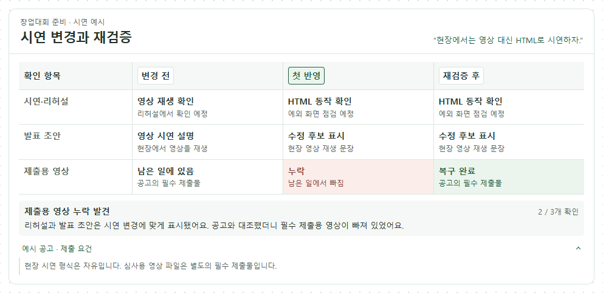

# 시연 방식 변경 후 재검증

[v4 기획안](README.md) · [클릭 시안](previews/project-change-revalidation.html)

> “현장에서는 영상 대신 HTML로 시연하자.”

창업대회를 준비하는 팀이 이 한 줄을 남긴다. 예시 공고에는 “현장 시연 형식은 자유입니다. 심사용 영상 파일은 별도의 필수 제출물입니다.”라고 적혀 있다. 에이전트가 처음 반영할 때 두 영상의 용도를 혼동해 제출용 영상까지 남은 일에서 뺀 상황을 시연한다.

## 확인할 세 가지

| 항목 | 변경 전 | 첫 반영 | 재검증 후 |
| --- | --- | --- | --- |
| 시연·리허설 | 영상 재생 확인 | HTML 동작 확인으로 변경. 예외 화면 점검은 남은 일 | HTML 동작 확인 유지 |
| 발표 초안 | ‘현장에서 영상을 재생’ 문구 | 해당 문장을 찾아 수정 후보로 표시 | 수정 후보 유지 |
| 제출용 영상 | 필수 제출 작업이 남아 있음 | 남은 일에서 빠짐 | 공고 근거와 함께 원래 제출 작업 복구 |

## 에이전트가 찾고 고치는 순서

1. **영향 범위를 찾는다.** 현재 계획에서 현장 시연 단계와 연결된 리허설을 읽는다. 발표 초안에서 현장 시연을 설명하는 문장을 찾아 수정 후보로 표시한다. 계획에 링크가 없으면 지정 자료에서 발표 초안과 공고를 찾고, 관련 문서의 최신 버전을 확인한다. 공고의 ‘심사용 영상 파일’은 제출 작업의 조건으로 읽는다.
2. **첫 반영을 원문과 대조한다.** 이 시연에서 에이전트는 시연 준비와 자료 정리를 한 번에 바꾸다가 제출 작업을 누락한다. 임시 저장한 결과를 다시 읽고 사용자의 원래 요청, 공고의 별도 제출 조건, 발표 초안의 문장과 대조한다. 첫 반영 전 계획에 있던 필수 제출 작업이 빠졌음을 발견한다.
3. **빠진 작업을 되돌린다.** 첫 반영 전 계획에서 제출 작업의 기한과 첨부 조건을 가져와 제자리로 복구한다. 갱신된 계획에서 남은 일과 단계 완료율을 다시 계산하고 위 세 항목을 대조한다. 세 항목이 맞으면 현재 계획을 확정하고 진행 화면에 ‘반영 완료’를 표시한다. 발표 초안에는 수정할 문장을 남겨두고, 사용자가 반영을 요청할 때 초안을 편집한다.

보다 최근에 사용자가 계획을 바꿨다면 최신 계획을 다시 읽고 그 버전에 정정을 적용한다. 공고가 열리지 않거나 공고끼리 제출 조건이 충돌하면 제출 작업에 마지막으로 확인한 상태를 유지하고, 관련 자료와 이유를 **확인 필요**로 표시한다. 확인한 시연 변경은 진행 화면의 해당 할 일에서 볼 수 있다. 사용자는 같은 창에서 바뀐 항목과 근거를 펼쳐본다.

이미 연결된 파일 조회와 완료율 계산은 프로그램이 맡는다. 에이전트가 판단할 부분은 **링크가 없는 초안에서 바뀐 결정이 가리키는 문장을 찾고, 같은 ‘영상’이라는 말이 가리키는 용도를 원문에서 구별하는 일**이다. 지정 자료 안에서 관련 파일을 찾아 버전별로 한 번씩 검토한다. 관련 자료를 모두 봤거나 연관된 내용을 더 찾을 수 없을 때 탐색을 마치고, 읽을 수 없었던 자료를 표시한다.

## 비교 시연 방법

파일을 읽고 수정할 수 있는 범용 에이전트에도 동일한 초기 계획, 발표 초안, 예시 공고와 한 줄 요청을 제공한다. 모델과 파일 권한을 맞추고, 초기 계획에 직접 연결되지 않은 발표 초안도 두 쪽이 같은 폴더에서 찾을 수 있게 둔다. 위 세 항목을 채점 전에 확정한다. 최종 반영에서 빠진 항목, 영향 범위를 벗어난 수정, 사용자가 추가로 알려줘야 했던 내용을 각각 센다. 첫 반영에서 누락이 발생했다면 끝나기 전에 에이전트가 자체적으로 찾아 복구했는지도 기록한다. 이 문서와 시안은 검증 방법을 설명하는 예시다.
