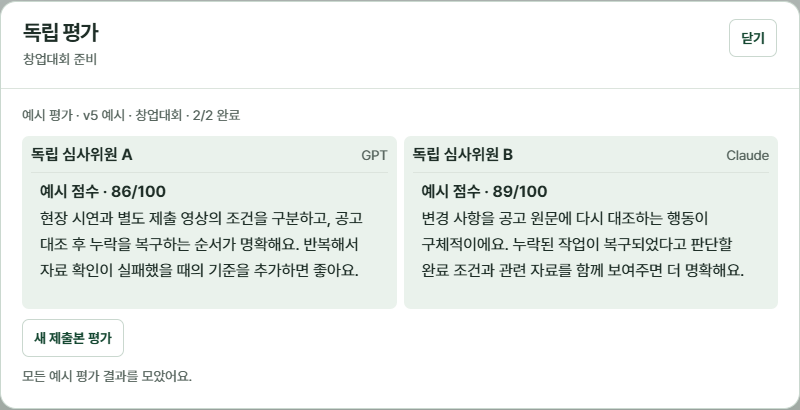

# 프로젝트 작업 기록 에이전트 v5

**Agentic AI 아이디어 공모전 기획안 · 2026년 11월 28일**

공모전이나 연구 프로젝트에서 한 줄로 작업이나 변경 결정을 남기면, 에이전트가 현재 계획과 관련 자료를 확인해 갱신한다. 프로젝트를 마치면 같은 기록으로 내가 맡은 역할과 문제 해결 과정을 담은 공개 소개 페이지를 준비한다. 중간에 기획안을 검토하고 싶을 때는 제출본과 기준을 한 번 입력해 독립 평가를 요청할 수 있다.

## 사용자가 보는 화면

| 화면 | 확인할 내용 |
| --- | --- |
| **프로젝트 홈** | 종류별 프로젝트와 태그, 목표일, 시작 후 주차, 남은 기간과 완료율. 작업한 프로젝트 수가 많을수록 날짜의 색이 진해지고, 아이디어 메모는 필요할 때 프로젝트로 전환할 수 있다. |
| **프로젝트 상세** | 날짜별 작업 로그와 현재 계획. 완료한 단계는 진행 목록 위에서 펼쳐볼 수 있다. 작업에 연결된 파일과 근거, 문제와 해결 사례도 여기에서 확인한다. |
| **산출물** | 별도 창에서 방문자가 보게 될 프로젝트 소개를 미리 본다. 공개 시에는 사용자가 승인한 문안과 자료를 반영한다. |
| **AI 프리셋** | 창업대회·연구실 등 유형마다 저장된 진행·독립 평가·검수 블록을 본다. AI에 필요한 작업이나 평가 방향을 말하면 설정을 구성하고, 사용자는 모델과 프롬프트를 열어 확인한다. |

## 한 줄 변경이 반영되는 곳

대회 팀이 “현장에서는 영상 대신 HTML로 시연하자. 기본 화면은 연결했고 예외 화면은 확인 중이야”라고 남긴다. 에이전트는 **팀의 변경 결정**과 **이미 수행한 작업**을 구분해 기록한다. 리허설에서 바꿔야 할 항목과 발표 초안의 시연 설명을 찾고, 예외 화면 점검이 남았으므로 시연 준비를 진행 중으로 표시한다.

반영 후에는 원래 공고를 다시 확인한다. 현장 시연과 별도로 영상 파일을 제출해야 한다면 누락된 영상 제출 작업을 되살리고, 마감과 파일 조건이 보존됐는지 점검한다. 작업 로그에서 문제와 대응, 확인 결과를 연결해 두면 프로젝트 소개에도 같은 근거를 쓸 수 있다.

## 독립 평가

1. 프로젝트에서 **독립 평가**를 열어 제출본과 공통 기준을 한 번 입력한다. 제출본 버전을 붙일 수 있다.
2. 연결된 프리셋의 심사위원마다 별도 세션을 열어 같은 제출본과 기준, 그 심사위원에게 저장된 지시만 전달한다. 사용자는 각 세션의 완료 상태를 확인한다.
3. 모든 평가가 끝나면 각 심사위원의 점수와 근거가 한 화면에 모인다. 평가 기록은 제출본별로 열어볼 수 있다.

## 클릭 시안

[시안 HTML](previews/project-home-preview.html)을 열어 **창업대회 준비 → 독립 평가 → 예시 불러오기 → 자동 평가 시작**으로 진행한다. GitHub에서는 HTML을 다운로드해 브라우저에서 열 수 있다. 산출물 안의 예시 이미지는 저장소를 함께 내려받으면 표시된다. **AI 프리셋 관리**에서는 저장된 설정과 평가 방향 요청 예시를 볼 수 있다.

시안은 브라우저에서 평가 입력 분리, 완료 상태, 결과 공개 시점을 재현한다. 프리셋 구성과 평가 답변은 예시이며, 모델 연결과 프로젝트 파일 자동 분석은 [동작·검증 기준](workflow.md)에 정의한 기획 범위다.
